<!-- ══════════════════ DYNAMIC ANIMATED 3D WebXR HERO BANNER ══════════════════ -->

  

<!-- ══════════════════ SLEEK UNIFIED SOCIAL BAR ══════════════════ -->

  
  &nbsp;
  
  &nbsp;
  
  &nbsp;
  

---

### 🚀 About Me

> **"Bridging real-time 3D spatial computing with high-scale enterprise architectures."**  
>  
> Final-year **BSc (Hons) Software Engineering** student at **Cardiff Metropolitan University** ('26). I specialize in **Three.js, WebGL shaders, interactive GSAP animations**, and **scalable backend services with Spring Boot and Node.js**.

---

### 🛰️ Featured Projects

  
  

  
  &nbsp;&nbsp;&nbsp;&nbsp;&nbsp;&nbsp;&nbsp;&nbsp;&nbsp;&nbsp;&nbsp;&nbsp;&nbsp;&nbsp;&nbsp;&nbsp;&nbsp;&nbsp;&nbsp;&nbsp;&nbsp;&nbsp;&nbsp;&nbsp;&nbsp;&nbsp;&nbsp;&nbsp;&nbsp;&nbsp;&nbsp;&nbsp;&nbsp;&nbsp;&nbsp;&nbsp;&nbsp;&nbsp;&nbsp;&nbsp;&nbsp;&nbsp;&nbsp;
  

 

  
  

  
  &nbsp;&nbsp;&nbsp;&nbsp;&nbsp;&nbsp;&nbsp;&nbsp;&nbsp;&nbsp;&nbsp;&nbsp;&nbsp;&nbsp;&nbsp;&nbsp;&nbsp;&nbsp;&nbsp;&nbsp;&nbsp;&nbsp;&nbsp;&nbsp;&nbsp;&nbsp;&nbsp;&nbsp;&nbsp;&nbsp;&nbsp;&nbsp;&nbsp;&nbsp;&nbsp;&nbsp;&nbsp;&nbsp;&nbsp;&nbsp;&nbsp;&nbsp;&nbsp;
  

---

### ⚡ Technologies & Core Arsenal

 

 

* 🌌 **3D & Spatial WebXR:** Three.js • WebGL Shaders • WebXR (AR/VR) • GSAP ScrollTrigger • Lenis 60 FPS
* 💻 **Frontend Architecture:** TypeScript • JavaScript (ES6+) • React.js • Next.js • Tailwind CSS • Framer Motion
* ⚙️ **Backend & Cloud:** Java (OOP) • Spring Boot • Node.js • Express.js • Python • RESTful APIs
* 🗄️ **Databases & DevOps:** MySQL • MongoDB • PostgreSQL • Hibernate JPA • Docker • Git • Vercel

---

### 📊 GitHub Activity & Telemetry

  

<!-- ANIMATED COMMIT SNAKE -->
<picture>
  <source media="(prefers-color-scheme: dark)" srcset="https://raw.githubusercontent.com/C-KAVISHKA/C-KAVISHKA/output/github-contribution-grid-snake-dark.svg">
  <source media="(prefers-color-scheme: light)" srcset="https://raw.githubusercontent.com/C-KAVISHKA/C-KAVISHKA/output/github-contribution-grid-snake.svg">
  
</picture>

---

### 🌐 Let's Build Something Exceptional

Feel free to connect for software engineering roles, collaborations, or technical discussions:

&nbsp;

&nbsp;

  

Designed & Engineered by **Channa Kavishka** • Cardiff Metropolitan University '26

