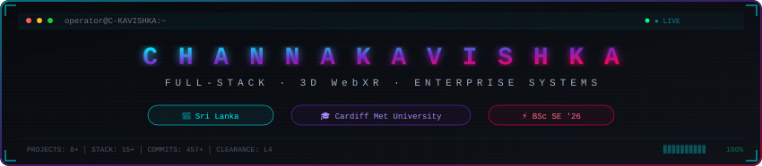
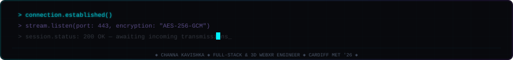

<div align="center">

<!-- HEADER -->


<br/>

<a href="https://c-kavishka.github.io">
  
</a>

</div>


<br/>

<div align="center">
<table>
<tr><td>

```js
const kavishka = {
    role:       "Full-Stack & 3D WebXR Software Engineer",
    education:  "BSc (Hons) Software Engineering — Cardiff Met (2026)",
    focus:      ["Three.js/WebGL", "React/Next.js", "Spring Boot", "Node.js"],
    languages:  ["TypeScript", "JavaScript", "Java", "Python", "Rust"],
    status:     "Open for Software Engineering opportunities"
};
```

</td></tr>
</table>
</div>

<br/>


<h3 align="center"><samp>TECH STACK</samp></h3>

<div align="center">

<br/>


</div>

<br/>


<h3 align="center"><samp>FEATURED PROJECTS</samp></h3>

<div align="center">
<table>
<tr>
<td width="50%" valign="top">

### [Cafe Nuwara](https://github.com/C-KAVISHKA/cafe-nuwara)
**Interactive 3D Burger Cafe Experience**

WebGL entrance sequences, GSAP scroll-driven burger anatomy animations, Lenis smooth scrolling

  

[`SOURCE`](https://github.com/C-KAVISHKA/cafe-nuwara) · [`LIVE DEMO`](https://cafe-nuwara.vercel.app)

</td>
<td width="50%" valign="top">

### [ApparelFlow ERP](https://github.com/C-KAVISHKA/apparelflow-erp)
**Enterprise Resource Planning System**

Garment production management, order tracking, real-time inventory, multi-tier workflow engine

  

[`SOURCE`](https://github.com/C-KAVISHKA/apparelflow-erp)

</td>
</tr>
<tr>
<td width="50%" valign="top">

### [iFurnish Shop](https://github.com/C-KAVISHKA/iFurnish_Shop)
**AI-Powered Furniture Platform**

Intelligent recommendation engine, chatbot modules, and 3D product preview integration

  

[`SOURCE`](https://github.com/C-KAVISHKA/iFurnish_Shop)

</td>
<td width="50%" valign="top">

### [Oceanview Reservations](https://github.com/C-KAVISHKA/oceanview-reservation-system)
**Hotel Booking System**

Room availability lifecycle, booking workflows, guest check-in/out, transactional MySQL persistence

  

[`SOURCE`](https://github.com/C-KAVISHKA/oceanview-reservation-system)

</td>
</tr>
<tr>
<td width="50%" valign="top">

### [HealthShield AI](https://github.com/C-KAVISHKA/healthshield_ai)
**Healthcare EHR Backend**

Electronic health records, RBAC, patient diagnostics, ACID-compliant data persistence

  

[`SOURCE`](https://github.com/C-KAVISHKA/healthshield_ai)

</td>
<td width="50%" valign="top">

### [Claw-Code](https://github.com/C-KAVISHKA/claw-code)
**Developer Harness Tools**

High-performance dev utilities for workflow automation — rewriting core engine in Rust

 

[`SOURCE`](https://github.com/C-KAVISHKA/claw-code)

</td>
</tr>
</table>
</div>

<br/>


<h3 align="center"><samp>STATS</samp></h3>

<div align="center">


</div>

<br/>


<h3 align="center"><samp>CONNECT</samp></h3>

<div align="center">

[](https://c-kavishka.github.io)&nbsp;&nbsp;
[](https://linkedin.com/in/channa-sandaruwan)&nbsp;&nbsp;
[](mailto:channasadhruvan@gmail.com)

</div>

<br/>


